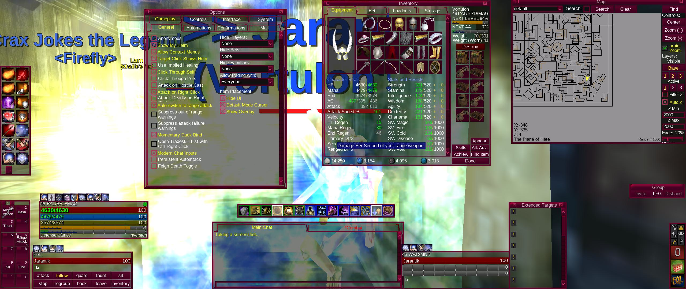
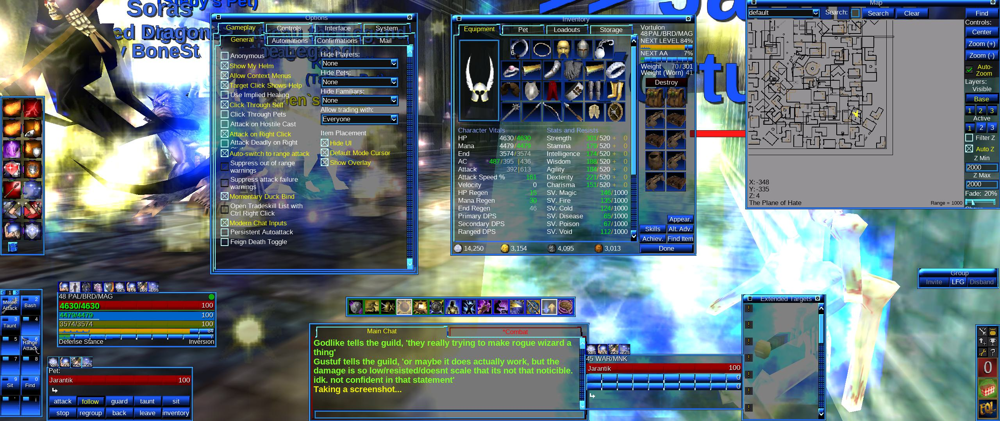
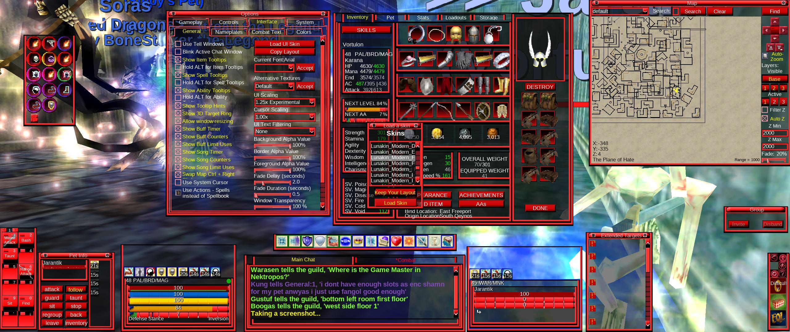
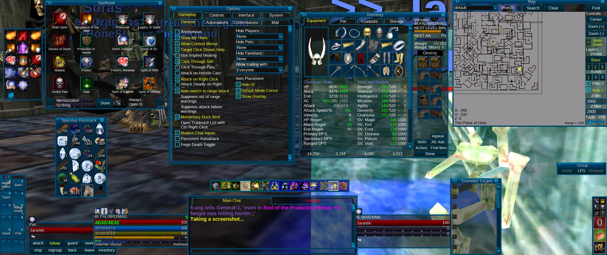
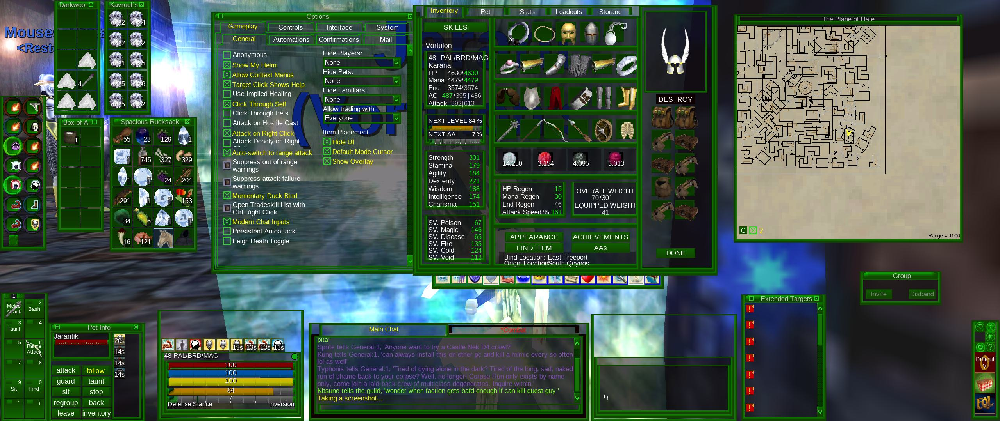
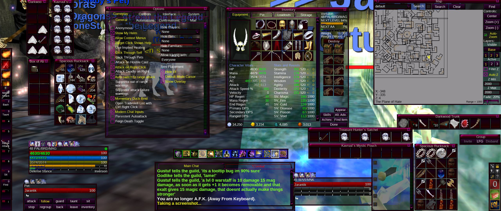
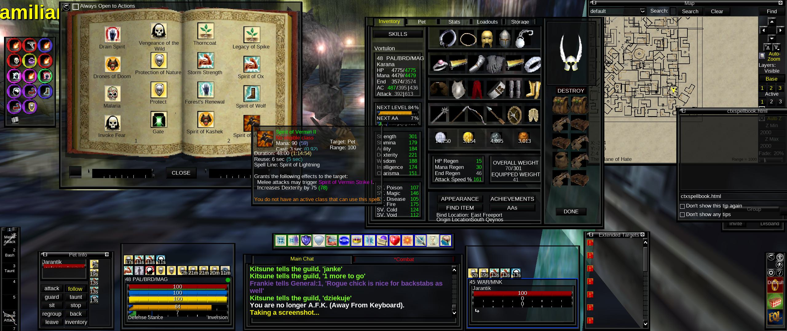
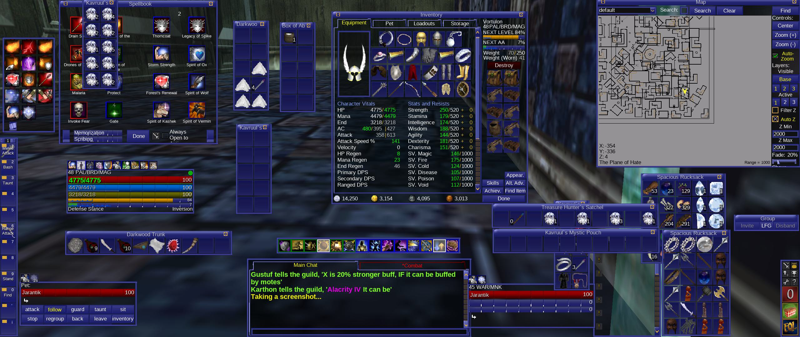
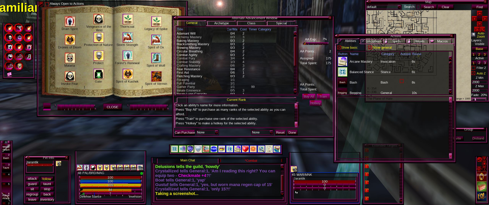
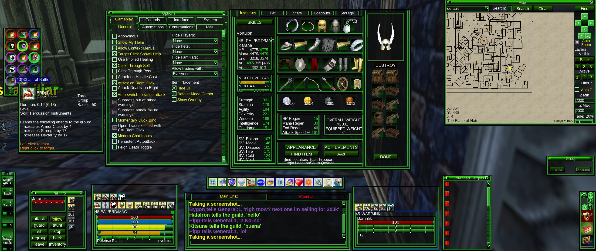

# 🌙✨ Lunakin Legendary 🐉⚔️

**EverQuest Legends UIs by brujoloco** 🧙‍♂️🏰

This is the continuation of my **Lunakin Quarmified** UI — fixed, rebuilt and polished for **EverQuest Legends**! 🪨✨ Same lunar soul, new home in Norrath.

## 🫂 The skins

Two families, 34 colorways each — **68 skins in total**, and no skin sits above the others; they are all equal siblings of the moon:

🪨 **Classic family** — `Lunakin_Classic_<Color>`:
Bertie · Black · Blooddark · Blooddelight · Bloodsabers · Blue · Dirt · Evilplum · Flux · Fuchsia · Grass · Green · Iceking · IksarPeach · Jungle · Laika · Lettuce · Mire · Neongreen · Ochre · OrderOfThree · Papi · Red · Rochelle · Rotborn · RotKnight · SpicyOnion · Staticgrape · Suave · Surf · Swamp · Tangerine · Tarnish · Toxic

🌊 **Modern family** — `Lunakin_Modern_<Color>`:
the same 34 colorways on the modern base.

## 🛠️ Install

⚔️ Copy the skin folders you fancy into your EverQuest Legends `uifiles` folder:

```
.../Daybreak Game Company/Installed Games/EverQuest Legends/uifiles/
```

Then select your colorway from the skin selector in Options. That's it — no other steps! ⚡ They're lean by design: anything identical to stock is served by your own `default` folder, so they load faster too.

## 📜 Updates

Updates will be forthcoming **for as long as I play the game** 🐉 — new colorways, fixes and polish as Norrath moves me. Keep an eye on this repo! 👁️🌙

## 🤗 Welcome, traveler!

A **warm welcome and a big hug from the Qeynos server!** 🏰🤗🍀 May your bags be heavy with platinum, your mana bar full, and your corpses few and far between. See you in Norrath! 🌙🐉

## 📸 The Lunakin look, live!

Straight from my screen in Qeynos — feast your eyes, traveler! 👀✨



















